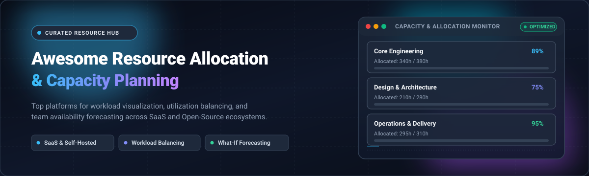

# ⚡ Awesome Resource Allocation & Capacity Planning

  

  
  
  
  
  
  
  

> 🎯 A curated directory of top **Resource Allocation**, **Capacity Planning**, and **Workload Management** platforms — featuring SaaS/hosted enterprise solutions and open-source alternatives to balance team bandwidth, forecast availability, eliminate bottlenecks, and optimize project schedules.
>
> 🌟 **Star this repository** if you find it helpful for your engineering, agency, or enterprise planning workflow!

---

## 📑 Table of Contents

- [🌐 Sector Overview & Market Dynamics](#-sector-overview--market-dynamics)
- [🏢 SaaS / Hosted Commercial Platforms](#-saas--hosted-commercial-platforms)
- [💻 Open-Source Software](#-open-source-software)
  - [1. Plane](#1-plane-)
  - [2. ERPNext](#2-erpnext-)
  - [3. OpenProject](#3-openproject-)
  - [4. Leantime](#4-leantime-)
  - [5. Worklenz](#5-worklenz-)
  - [6. Timefold Solver](#6-timefold-solver-)
  - [7. TaskJuggler](#7-taskjuggler-)
  - [8. LibrePlan](#8-libreplan-)
  - [9. Capacity Planning Feature Monte Carlo](#9-capacity-planning-feature-monte-carlo-)
  - [10. Resource Planner](#10-resource-planner-)
  - [11. Jira Capacity Report](#11-jira-capacity-report-)
  - [12. Capacinator](#12-capacinator-)
  - [13. Qt Resource Planner](#13-qt-resource-planner-)
- [📊 Comparison Matrix](#-comparison-matrix)
- [📈 Star History](#-star-history)
- [💖 Support & Sponsorship](#-support--sponsorship)
- [🤝 Contributing](#-contributing)
- [📄 License](#-license)

---

## 🌐 Sector Overview & Market Dynamics

The global Resource Management and Capacity Planning software market is valued at approximately **$10 billion** and is projected to surpass **$30 billion by 2032**, expanding at a robust Compound Annual Growth Rate (**CAGR of ~15%–20%**). 

The sector is **moderately-to-highly fragmented** rather than a "winner-take-all" monopoly. Enterprise monoliths (such as Smartsheet, SAP, Workday, and Planview) cater to complex portfolio governance in Fortune 500 corporations, while nimble specialized platforms (like Runn, Float, and Resource Guru) and transparent open-source tools dominate agile agencies, consultancies, and engineering organizations prioritizing flexibility, API extensibility, and data sovereignty.

---

## 🏢 SaaS / Hosted Commercial Platforms

Below is an overview of leading cloud-hosted commercial platforms for resource allocation and capacity forecasting, sorted descending by company scale (valuation / annual revenue).

| 🏢 Platform | 💰 Company Valuation / Revenue | 🏷️ Starting Tier Pricing | 🎁 Free Tier / Trial Limit | 🎯 Primary Focus & Strengths |
|:---|:---|:---|:---|:---|
| **Smartsheet Resource Management** | **~$8.4 Billion valuation** ($500M–$1B+ ARR; acquired by Blackstone & Vista Equity) | **$9 per member/month** (Pro plan, billed annually) | **No permanent free tier** (30-day full-featured free trial with all grids, sheet automation & views) | Enterprise work execution and resource scheduling across large cross-functional portfolios. |
| **Saviom** | **~$12M – $25M ARR** (Bootstrapped global enterprise vendor) | **Custom Enterprise Quote** (Starts ~$15–$30/user/mo based on deployment scale) | **No permanent free tier** (60-day guided enterprise pilot trial with custom data imports) | Enterprise resource management, skills inventory, matrix team forecasting & multi-project pipeline balancing. |
| **Float** | **~$7.8M ARR** (Privately held, bootstrapped/scale-up) | **$6 per user/month** (Starter Resource Planning plan, billed annually) | **No permanent free tier** (14-day unrestricted free trial with all features and unlimited projects) | Visual team scheduling, calendar drag-and-drop allocations, and agency utilization forecasting. |
| **Runn** | **~$6.9M ARR** (Venture-backed scale-up, ~$1.9M raised) | **$7 per person/month** (Lite tier, billed annually) | **No permanent free tier** (14-day free trial; free access for non-managing team members) | Capacity forecasting vs. project demand, real-time availability heatmaps, and budget modeling. |
| **Resource Guru** | **~$4.4M ARR** (Privately held, backed by Index Ventures & Seedcamp) | **$4.16 per person/month** (Grasshopper plan, billed annually at $5/mo monthly) | **No permanent free tier** (30-day free trial with full feature access, no credit card required) | Lightweight visual calendar scheduling for teams and meeting rooms with clash management. |
| **Forecast (by ProSymmetry)** | **~$1M – $4.3M ARR** (Privately held enterprise software developer) | **Custom Enterprise Quote** (Tiered contracts tailored by seat volume and planning scope) | **No permanent free tier** (30-day guided enterprise trial via assisted engineering onboarding) | Algorithmic "what-if" capacity simulation, scenario planning, and complex skills matching. |
| **Teamdeck** | **~$700K ARR** (Privately held boutique software company) | **$3.99 per user/month** (Basic resource scheduling tier) | **No permanent free tier** (7-day full access free trial with unlimited resource profiles) | Lightweight resource scheduling, timesheets, and leave tracking built for creative teams. |

---

## 💻 Open-Source Software

Self-hosted, transparent, and community-driven resource scheduling and capacity planning platforms. Repositories are listed in descending order by GitHub stars.

### 1. Plane 🚀

- **Repository:** [makeplane/plane](https://github.com/makeplane/plane)
- **Tech Stack:** TypeScript, Python, Next.js, Django, PostgreSQL, Docker
- **License:** Apache-2.0
- **Overview:** Plane is an open-source project management suite built as a modern alternative to Jira and Linear. It offers robust cycles, modules, issue planning, workload management, and analytics to track team velocity and capacity across parallel engineering sprints.

### 2. ERPNext 💼

- **Repository:** [frappe/erpnext](https://github.com/frappe/erpnext)
- **Tech Stack:** Python (Frappe Framework), JavaScript, MariaDB, Redis
- **License:** GPL-3.0
- **Overview:** Complete open-source enterprise resource planning (ERP) platform featuring dedicated project management and resource scheduling modules. Integrates timesheet entries, project costing, skill allocation, employee capacity limits, and human resource management in a single database.

### 3. OpenProject 📅

- **Repository:** [opf/openproject](https://github.com/opf/openproject)
- **Tech Stack:** Ruby on Rails, Angular, PostgreSQL, Docker
- **License:** GPL-3.0
- **Overview:** OpenProject provides comprehensive project portfolio management with dedicated resource management views. Visualizes team workload timelines, department allocation, individual working calendars, and highlights scheduling conflicts or overallocations across multiple projects.

### 4. Leantime 🎯

- **Repository:** [Leantime/leantime](https://github.com/Leantime/leantime)
- **Tech Stack:** PHP, JavaScript, MySQL, Docker
- **License:** AGPL-3.0
- **Overview:** An open-source, human-centric project management system for small teams and cross-functional innovators. Features milestone roadmapping, Kanban boards, timesheets, and workload views to prevent team burnout and track capacity.

### 5. Worklenz 👥

- **Repository:** [Worklenz/worklenz](https://github.com/Worklenz/worklenz)
- **Tech Stack:** TypeScript, Angular, Node.js, PostgreSQL
- **License:** Apache-2.0
- **Overview:** Designed specifically for project team workload and resource management. Provides live resource allocation dashboards, team bandwidth heatmaps, task estimations, and time logs to balance workloads across project members.

### 6. Timefold Solver 🧠

- **Repository:** [TimefoldAI/timefold-solver](https://github.com/TimefoldAI/timefold-solver)
- **Tech Stack:** Java, Kotlin, Python
- **License:** Apache-2.0
- **Overview:** An open-source AI constraint satisfaction and optimization solver (fork of OptaPlanner). Solves complex capacity planning problems such as employee shift rostering, resource leveling, vehicle routing, and task scheduling under hard and soft operational constraints.

### 7. TaskJuggler ⚙️

- **Repository:** [taskjuggler/TaskJuggler](https://github.com/taskjuggler/TaskJuggler)
- **Tech Stack:** Ruby
- **License:** GPL-2.0
- **Overview:** A powerful "planning-as-code" project management tool. Operates on plain-text declarative configuration to calculate critical paths, level resource allocations across competing projects, detect over-allocations, and generate detailed capacity reports.

### 8. LibrePlan 🌐

- **Repository:** [LibrePlan/libreplan](https://github.com/LibrePlan/libreplan)
- **Tech Stack:** Java, PostgreSQL, Docker
- **License:** AGPL-3.0
- **Overview:** A mature open-source web application designed specifically for project planning, resource allocation, and team governance. Supports manual and automated resource assignment based on worker skills, calendar holiday management, and global resource utilization graphs.

### 9. Capacity Planning Feature Monte Carlo 🎲

- **Repository:** [nbrown02/Capacity-Planning-Feature-Monte-Carlo](https://github.com/nbrown02/Capacity-Planning-Feature-Monte-Carlo)
- **Tech Stack:** Power BI, DAX, Jira API, Azure DevOps API
- **License:** MIT
- **Overview:** A quantitative capacity planning tool integrating with Jira and Azure DevOps to run Monte Carlo simulations. Accurately forecasts project delivery dates, sprint capacity risks, and required headcount based on historical throughput rather than subjective estimations.

### 10. Resource Planner 📊

- **Repository:** [quollnet/resource-planner](https://github.com/quollnet/resource-planner)
- **Tech Stack:** JavaScript, HTML5, Bootstrap, vis-timeline
- **License:** MIT
- **Overview:** A lightweight, interactive web timeline for resource allocation and capacity monitoring. Built on top of `vis-timeline.js`, providing simple drag-and-drop assignment of employees to projects, utilization tracking, and overload notifications.

### 11. Jira Capacity Report 📋

- **Repository:** [bitovi/jira-capacity-report](https://github.com/bitovi/jira-capacity-report)
- **Tech Stack:** JavaScript, React, Jira Cloud REST API
- **License:** MIT
- **Overview:** An open-source web application designed for agile teams and Program Increment (PI) planning. Directly interfaces with Jira Cloud via OAuth 2.0 to visualize team capacity vs. committed epics and stories over multi-sprint horizons.

### 12. Capacinator 💻

- **Repository:** [steiner385/Capacinator](https://github.com/steiner385/Capacinator)
- **Tech Stack:** TypeScript, React, SQLite, Electron
- **License:** MIT
- **Overview:** A desktop-first resource capacity planning and allocation tool for agile project managers. Stores data locally with zero server requirements, supporting Excel imports, team capacity overviews, and visual collision detection for overloaded team members.

### 13. Qt Resource Planner 🖥️

- **Repository:** [BaseMax/qt-resource-planner](https://github.com/BaseMax/qt-resource-planner)
- **Tech Stack:** Python, PyQt5, Qt
- **License:** GPL-3.0
- **Overview:** A lightweight desktop GUI resource planner built with Python and PyQt5. Supports visual task scheduling, resource assignments, Gantt charts, and allocation conflict detection without external cloud dependencies.

---

## 📊 Comparison Matrix

| 🛠️ Platform | 📜 License / Type | 🧰 Technology Stack | 🔮 Capacity Forecasting | ⚠️ Conflict / Overload Detection | 🏠 Self-Hosted | 🎯 Best Use Case |
|:---|:---|:---|:---:|:---:|:---:|:---|
| **Smartsheet RM** | Commercial SaaS | Cloud-Hosted | ✅ Enterprise Demand | ✅ Real-time Overload | ❌ | Multi-department enterprise resource governance |
| **Saviom** | Commercial SaaS | Cloud-Hosted | ✅ Multi-scenario Forecast | ✅ Capacity Bottlenecks | ❌ | Enterprise matrix organizations & professional services |
| **Float** | Commercial SaaS | Cloud-Hosted | ✅ Team Utilization | ✅ Visual Overbooking | ❌ | Fast-paced agencies & design/dev studios |
| **Runn** | Commercial SaaS | Cloud-Hosted | ✅ Supply vs. Demand | ✅ Capacity Heatmaps | ❌ | Growth tech companies & consulting firms |
| **Resource Guru** | Commercial SaaS | Cloud-Hosted | ✅ Availability Forecast | ✅ Clashes & Waiting Lists | ❌ | Simple team and physical asset scheduling |
| **Plane** | Open-Source (Apache-2.0) | TypeScript / Python | ✅ Sprints & Cycles | ✅ Workload Tracking | ✅ | Modern engineering teams replacing Jira |
| **ERPNext** | Open-Source (GPL-3.0) | Python / MariaDB | ✅ Enterprise Budgets | ✅ Resource Allocation | ✅ | Full organizational resource & ERP management |
| **OpenProject** | Open-Source (GPL-3.0) | Ruby / PostgreSQL | ✅ Timeline Forecast | ✅ Visual Overallocation | ✅ | Regulated enterprises & public sector PM |
| **Leantime** | Open-Source (AGPL-3.0) | PHP / MySQL | ✅ Milestone Bandwidth | ✅ Overload Indicators | ✅ | Small cross-functional product teams |
| **Worklenz** | Open-Source (Apache-2.0) | TypeScript / Angular | ✅ Team Bandwidth | ✅ Bandwidth Heatmaps | ✅ | Agency resource balancing & project tracking |
| **Timefold Solver** | Open-Source (Apache-2.0) | Java / Python | ✅ Algorithmic Optimization | ✅ Automated Constraint Solving | ✅ | Mathematical capacity & roster optimization |
| **TaskJuggler** | Open-Source (GPL-2.0) | Ruby | ✅ Declarative Leveling | ✅ Mathematical Constraints | ✅ | Technical engineers favoring planning-as-code |
| **LibrePlan** | Open-Source (AGPL-3.0) | Java / PostgreSQL | ✅ Global Utilization | ✅ Workload Thresholds | ✅ | Government & academic resource planning |
| **Capacinator** | Open-Source (MIT) | Electron / SQLite | ✅ Project Analytics | ✅ Assignment Conflicts | ✅ (Local) | Solo project managers needing local offline planning |

---

## 📈 Star History

---

## 💖 Support & Sponsorship

Thank you for visiting and using this curated resource guide! Building and maintaining comprehensive open-source lists takes continuous effort, research, and community validation.

If this repository has helped you evaluate tools, optimize your team's utilization, or save time:
- ⭐ **Star this repository** to help others discover it.
- 🍴 **Fork it** to customize your organization's internal planning stack.
- 📢 **Share it** with fellow project managers, scrum masters, and engineering leads.
- ☕ **Support future development:** You can sponsor the creator or buy a coffee via the [GitHub Sponsor Dashboard](https://github.com/sponsors/ishandutta2007).

---

## 🤝 Contributing

Contributions are warmly welcomed! If you have built or discovered an open-source Resource Allocation or Capacity Planning solution that belongs here:

1. 🍴 Fork the repository.
2. 🌿 Create a new branch: `git checkout -b add-tool-name`.
3. 📝 Add your tool in the relevant section maintaining the descending star ranking format.
4. 🚀 Submit a Pull Request with a clear description of the project and why it stands out.

Please ensure submitted tools are actively maintained with clear open-source licensing.

---

## 📄 License

This curated collection is made available under the [Creative Commons Zero v1.0 Universal (CC0 1.0)](https://creativecommons.org/publicdomain/zero/1.0/) Public Domain Dedication. Individual software platforms mentioned retain their respective copyrights and licenses.